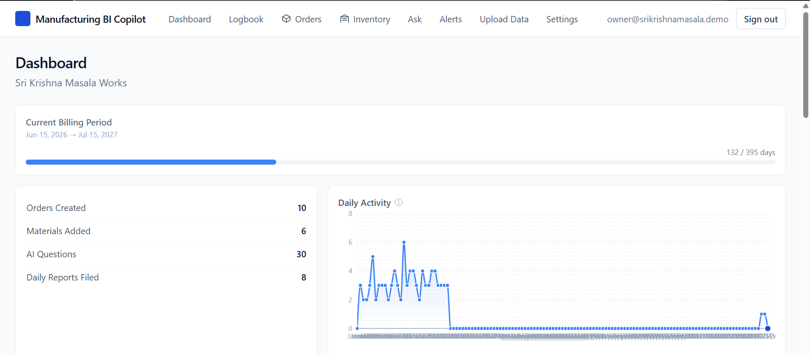
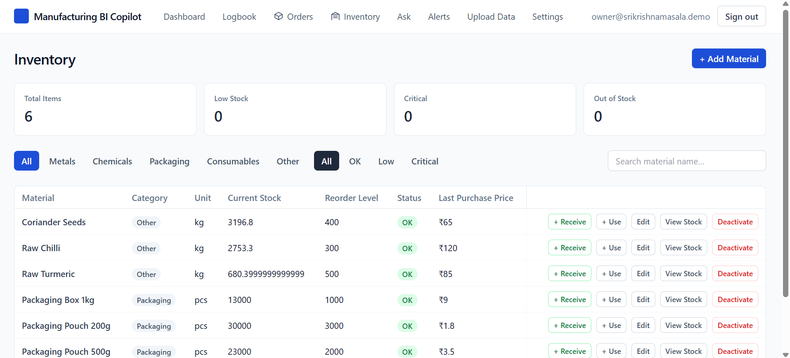
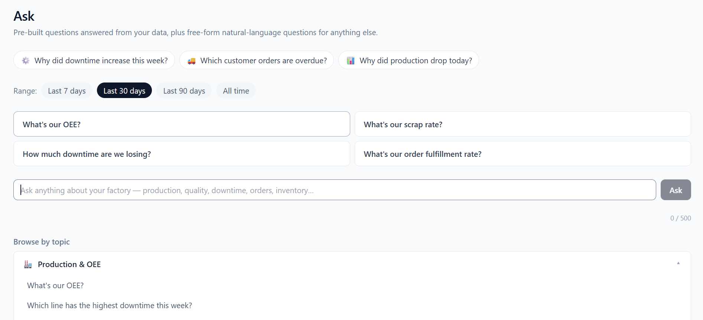
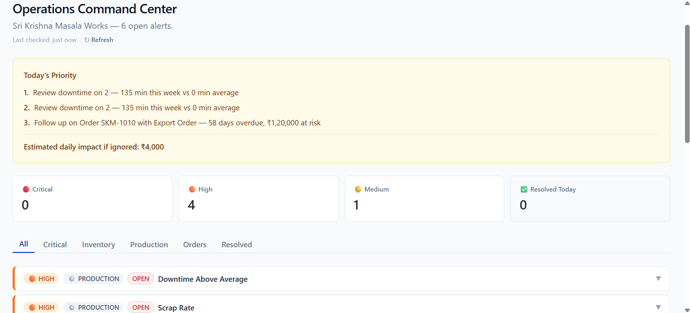

# Manufacturing BI Copilot

### AI-Powered Manufacturing Analytics and Decision Support

Manufacturing BI Copilot helps manufacturing teams analyze production
data, identify anomalies, forecast production, predict potential machine
failures, and investigate manufacturing problems.

The platform brings manufacturing analytics and AI-powered insights
together to help teams better understand their operations and make
data-informed decisions.

---

## Table of Contents

- [Overview](#overview)
- [Key Features](#key-features)
- [Screenshots](#screenshots)
- [Documentation](#documentation)
- [Manufacturing Problems We Address](#manufacturing-problems-we-address)
- [How It Works](#how-it-works)
- [Getting Started](#getting-started)
- [Who Is It For?](#who-is-it-for)
- [Product Demo](#product-demo)
- [Security and Data Handling](#security-and-data-handling)
- [Contact](#contact)

---

## Overview

Manufacturing BI Copilot is an AI-powered platform designed to help
manufacturing teams turn operational data into actionable insights.

It brings together data visualization, AI-assisted analysis,
anomaly detection, forecasting, and problem-solving capabilities.

The platform supports manufacturing teams in understanding production
performance, investigating operational issues, and making better
data-driven decisions.

## Key Features

### 1. Manufacturing Dashboards and Charts

Visualize manufacturing data through dashboards and charts to
understand production performance and operational trends.

### 2. Excel and CSV Data Analysis

Upload supported Excel and CSV files to analyze manufacturing data
and explore useful information from operational records.

### 3. AI-Powered Questions and Answers

Ask questions about available manufacturing data and use AI-assisted
analysis to understand important patterns and operational information.

### 4. Automatic Insights and Anomaly Detection

Identify unusual patterns and potential anomalies in manufacturing
data to help investigate issues that may require attention.

### 5. Production Forecasting and Machine Failure Prediction

Use forecasting and prediction capabilities to analyze production
trends and identify potential machine failure risks.

Predictions should be evaluated against actual operational outcomes.

### 6. ERP and SQL Database Integration

Connect with supported ERP systems and SQL databases to work with
manufacturing data from relevant business systems.

Refer to the technical documentation for supported integrations
and configuration requirements.

### 7. Problem Analysis and Recommended Solutions

Analyze manufacturing problems and generate AI-assisted explanations
and recommended actions to support investigation and decision-making.

Recommendations should be reviewed by qualified personnel before
being applied to real manufacturing operations.

---

## Screenshots

Explore the Manufacturing BI Copilot interface.

### Dashboard

Visualize manufacturing data and explore operational performance.

### Inventory

Explore inventory-related information and records.

### AI Assistant

Ask questions about available manufacturing data.

### Alerts

Review alerts and investigate potential issues.

More screenshots and feature explanations are available in the
documentation.

---

## Documentation

Explore the documentation to learn how to use the platform.

| Documentation | Description |
|---|---|
| User Guide | Learn how to navigate and use the platform. |
| Dashboard Guide | Understand dashboards, charts, and visualizations. |
| Data Upload Guide | Learn how to upload supported Excel and CSV files. |
| AI Assistant Guide | Learn how to ask questions about manufacturing data. |
| Automatic Insights Guide | Understand anomaly detection and automatic insights. |
| Forecasting Guide | Learn about production forecasting and machine failure prediction. |
| ERP and SQL Integration Guide | Explore supported data integrations. |
| Problem Analysis Guide | Learn about AI-assisted problem analysis and recommendations. |
| Troubleshooting | Find solutions to common issues. |
| FAQ | Find answers to frequently asked questions. |

**Full Documentation:** [Open the Documentation](./docs/README.md)

Update this link to match the actual location of your documentation files.

---

## Manufacturing Problems We Address

Manufacturing teams often need to understand operational data,
investigate production issues, and identify areas for improvement.

Manufacturing BI Copilot provides capabilities that support:

- Understanding production performance.
- Exploring manufacturing data.
- Identifying unusual data patterns.
- Forecasting production trends.
- Investigating potential machine failure risks.
- Analyzing inventory-related information.
- Investigating manufacturing problems.
- Exploring possible corrective actions.

The usefulness of each capability depends on the available data,
data quality, configuration, and operational context.

---

## How It Works

A typical workflow may involve:

1. **Access Data:** Upload supported files or connect an available
   data source.
2. **Explore Information:** Review dashboards, charts, and operational
   records.
3. **Ask Questions:** Use the AI assistant to investigate the available
   manufacturing data.
4. **Identify Patterns:** Explore automatic insights and potential
   anomalies.
5. **Analyze Trends:** Use available forecasting and prediction
   capabilities.
6. **Investigate Problems:** Review AI-assisted analysis and
   recommended actions.
7. **Make Decisions:** Evaluate the results and decide on appropriate
   operational actions.

Actual workflows depend on the features and data sources available
in your deployment.

---

## Getting Started

To get started:

1. Open the available Manufacturing BI Copilot application.
2. Follow the applicable access or sign-in instructions.
3. Navigate to the relevant section.
4. Upload supported data or access an available connected data source.
5. Explore the available analytics and AI capabilities.

For detailed instructions, consult the User Guide.

---

## Who Is It For?

Manufacturing BI Copilot is intended for people involved in
manufacturing operations and data analysis, including:

- Manufacturing business owners.
- Plant and factory managers.
- Production managers.
- Operations teams.
- Manufacturing analysts.
- Industrial engineers.
- Maintenance and reliability teams.

---

## Product Demo

Want to explore Manufacturing BI Copilot?

- **Live Application:** https://manufacturing.bhavu.co/
- **Request a Demo:** [Contact us on WhatsApp](https://wa.me/917709453058?text=Hi%2C%20I%27d%20like%20to%20request%20a%20demo%20of%20Manufacturing%20BI%20Copilot.)
- **Product Website:** https://manufacturing.bhavu.co/

Replace these placeholders with working links before publishing.

---

## Security and Data Handling

Data security and privacy are important when working with
manufacturing information.

Before using the platform with production or confidential business
data, review the applicable security documentation, data-handling
practices, access controls, and deployment requirements.

For details, refer to the verified security documentation.

---

## Contact

For product inquiries, feedback, or demonstration requests:

- **Website:** https://manufacturing.bhavu.co/
- **Request a Demo:** [Contact us on WhatsApp](https://wa.me/917709453058?text=Hi%2C%20I%27d%20like%20to%20request%20a%20demo%20of%20Manufacturing%20BI%20Copilot.)

Do not submit confidential manufacturing data, credentials,
or sensitive customer information through public issues.

---

## About This Repository

This repository contains public documentation and user guides for
Manufacturing BI Copilot.

The documentation is intended to help users understand the platform,
explore its capabilities, and learn how to use its features.

For documentation corrections or suggestions, follow the repository's
contribution guidelines.
