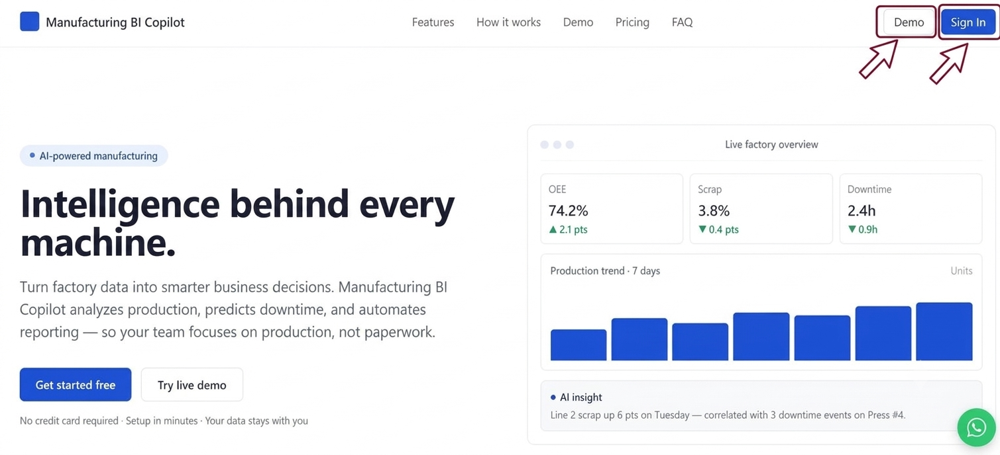
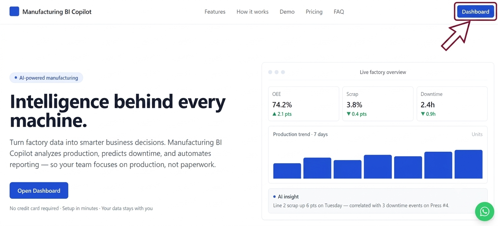
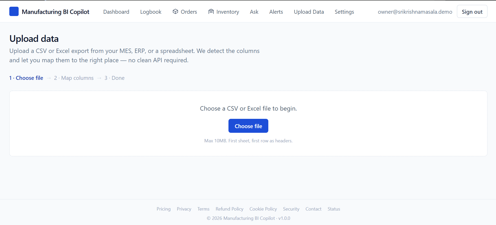
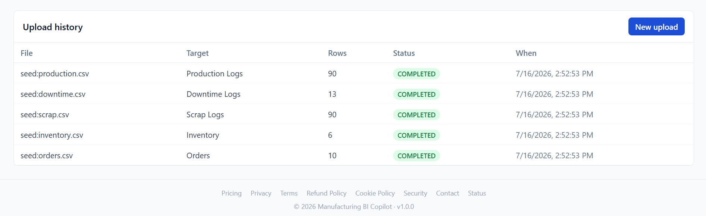
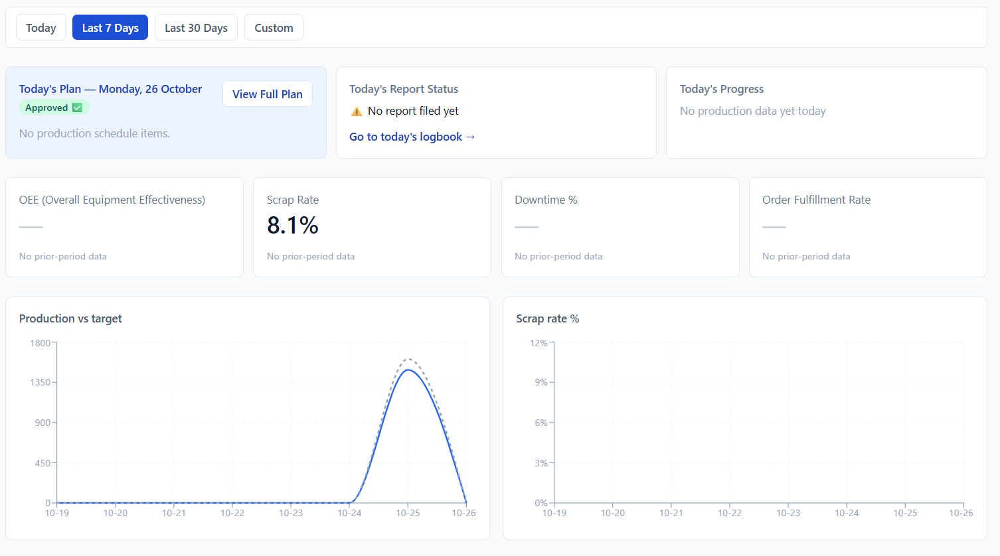
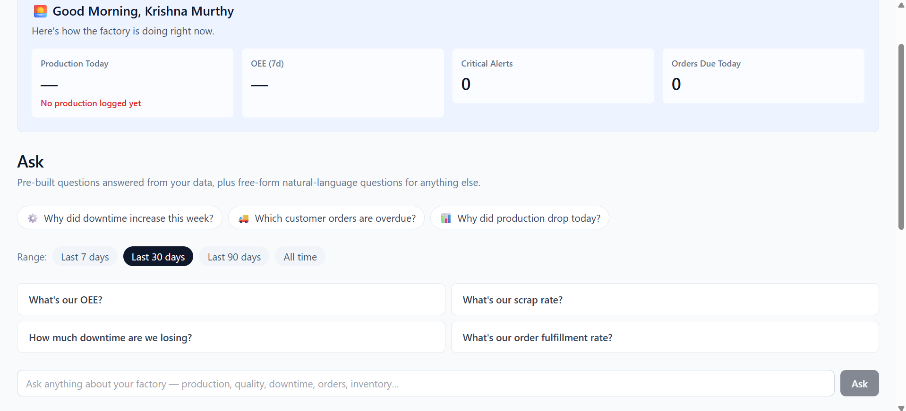
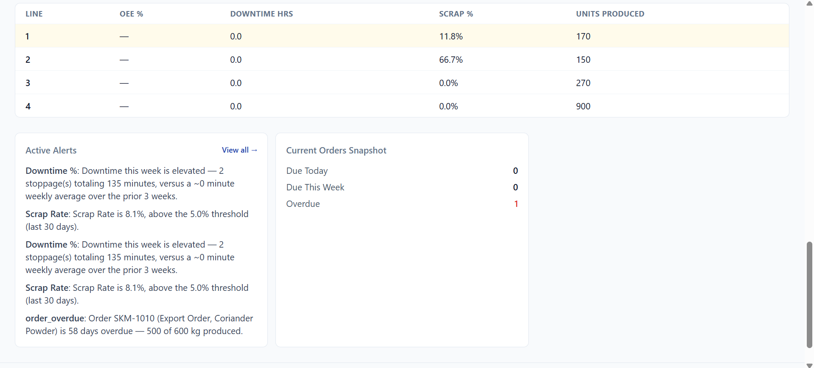
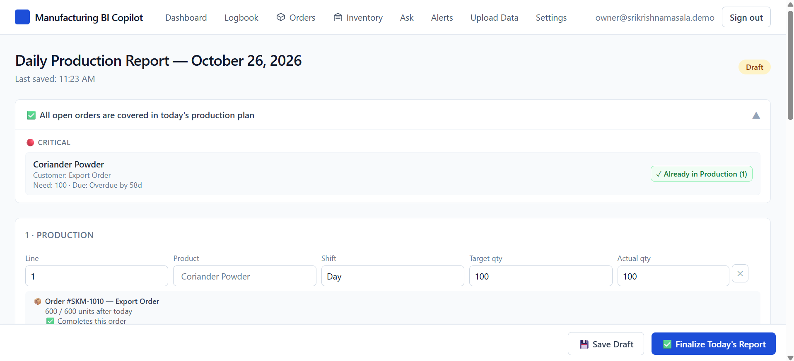
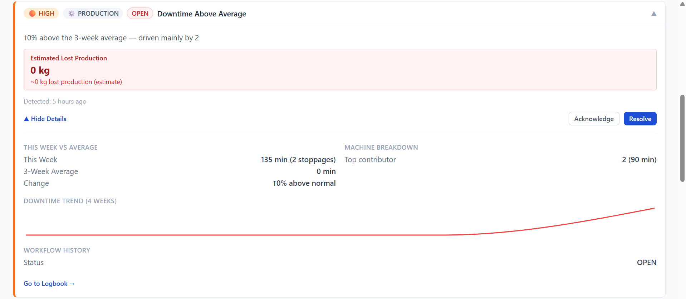

# Manufacturing BI Copilot — User Guide

**Document purpose:** Help users understand and use Manufacturing BI Copilot to analyse manufacturing data, monitor production performance, identify anomalies, predict future outcomes, and make data-driven decisions.

## 1. Introduction to Manufacturing BI Copilot

### What is Manufacturing BI Copilot?

Manufacturing BI Copilot is a manufacturing data analysis platform designed to help manufacturing businesses understand their production data and make informed decisions.

The platform provides seven core capabilities:

1. Interactive dashboards and charts.
2. Excel/CSV file uploads and data analysis.
3. AI-powered questions and answers.
4. Automatic insights and anomaly detection.
5. Production forecasting and machine failure prediction.
6. ERP and SQL database integration.
7. Problem analysis and recommended solutions.

### Who can use it?

The platform is intended for users such as:
- Plant managers.
- Production managers.
- Manufacturing engineers.
- Quality managers.
- Operations analysts.
- Business owners.

### What can users accomplish?

Users can explore production data, monitor key performance indicators (KPIs), ask questions about available data, investigate unusual patterns, and evaluate potential improvements.

**Important:** The actual results depend on the data available, the features enabled in the user's account, and the capabilities of the underlying models.

---

## 2. Getting Started

This section explains how a new user begins using the application.

### Step 1: Access the application
- Open the Manufacturing BI Copilot application.
- Sign in if authentication is required.
- Navigate to the main dashboard or workspace.

### Step 2: Understand the interface

Explain the purpose of each available area, using screenshots from the actual application.

For example:

| Interface area | Purpose |
|---|---|
| Dashboard | View manufacturing KPIs and charts |
| Data Upload | Upload supported Excel or CSV files |
| AI Assistant | Ask questions about available data |
| Insights | Review detected patterns and anomalies |
| Predictions | Review available forecasts |
| Integrations | Configure supported ERP or SQL connections |
| Recommendations | Review suggested actions |

*These are illustrative labels. The published guide should use the actual names and layout of your interface.*

### Step 3: Prepare your data

Before analysing manufacturing data, users should:
- Ensure column names are understandable.
- Check that numeric values use consistent formats.
- Verify date and timestamp formats.
- Remove unintended duplicate records.
- Check for missing or invalid values.
- Confirm that they have permission to upload or connect the data.

---

# 3. Feature 1 — Dashboards and Charts

### What does this feature do?

Dashboards help users understand manufacturing performance through visualisations and key performance indicators.

### How to use it

1. Open the dashboard.
2. Select the available dataset, production line, machine, or date range, if supported.
3. Review the displayed KPIs.
4. Explore charts to identify trends and changes.
5. Apply available filters.
6. Compare results across the selected periods or categories.

### Example

Suppose a manufacturing dataset contains:

| Metric | Value |
|---|---:|
| Total units produced | 1,000 |
| Defective units | 50 |
| Good units | 950 |

The defect rate is:

\[
\text{Defect Rate}=\frac{50}{1000}\times100=5\%
\]

A dashboard may display these values to help the user monitor production quality.

### What should users check?

- Are the selected dates correct?
- Does the KPI correspond to the displayed data?
- Are the filters applied correctly?
- Are units and labels clear?
- Is the dataset complete enough for the calculation?

### Common problems

**Problem:** A KPI displays an unexpected value.

**What to do:** Verify the underlying data, selected filters, calculation definition, and date range.

**Problem:** A chart contains no data.

**What to do:** Check whether data has been uploaded and whether the selected filters return any records.

## 1. Dashboard Overview

The dashboard provides an overview of your manufacturing
operations through KPIs, charts, and production metrics.

### Steps

1. Open Manufacturing BI Copilot.
2. Navigate to the Dashboard.
3. Review the displayed KPIs and charts.

### Screenshot

*Figure 1: Overview of the Manufacturing BI Copilot dashboard.*
---

# 4. Feature 2 — Excel/CSV Upload and Data Analysis

### What does this feature do?

This feature allows users to upload supported spreadsheet files and analyse their manufacturing data.

### How to upload a file

1. Open the data upload section.
2. Click on given Choose file buttom.
3. Select the file upload option.
4. Choose a supported Excel or CSV file.
5. Start the upload.
6. Wait for processing to complete.
7. Review any validation messages.
8. Open the imported dataset for analysis.

### Example dataset

| Date | Machine | Units Produced | Defects |
|---|---|---:|---:|
| 2026-10-01 | M-101 | 500 | 15 |
| 2026-10-02 | M-101 | 520 | 10 |
| 2026-10-03 | M-102 | 480 | 20 |

Users could analyse production volumes, defect rates, and differences between machines.

### Best practices

- Use consistent column names.
- Keep dates in a consistent format.
- Avoid mixing text and numbers in numeric columns.
- Check for missing values.
- Use only file formats and sizes supported by the application.

### Common problems

**Invalid file:** Confirm that the file format is supported and the file is not corrupted.

**Missing values:** Check the affected columns and determine whether the data needs correction.

**Upload failure:** Review the error message and retry after resolving the problem.

**Unexpected analysis results:** Compare the imported records with the original file.

*The guide should document the actual supported formats, maximum file size, and validation rules once these are confirmed in the application.*

---

# 5. Feature 3 — AI Questions and Answers

### What does this feature do?

The AI assistant allows users to ask questions about manufacturing data using natural language.

### How to ask a question

1. Upload or select the relevant dataset.
2. Open the AI assistant.
3. Enter a specific question.
4. Submit the question.
5. Review the answer and supporting data, if available.
6. Verify important results against the source data.

### Example questions

Users might ask:

- How many units were produced this month?
- Which machine recorded the highest defect count?
- What was the average daily production?
- How did production change compared with the previous period?
- Which production line had the highest rejection rate?

These questions are examples. The guide should only promise answers that the current implementation supports.

### How to obtain better answers

- Ask specific questions.
- Specify the relevant date range.
- Identify the machine or production line when necessary.
- Use clear metric names.
- Check the source data when an answer seems incorrect.

### What if the AI gives an incorrect answer?

1. Check that the correct dataset is selected.
2. Confirm that the required columns and records exist.
3. Review the calculation and filters.
4. Rephrase the question if it is ambiguous.
5. Report the issue if the answer still appears incorrect.

**Important:** AI-generated answers should be verified before being used for critical manufacturing or operational decisions.

---

# 6. Feature 4 — Automatic Insights and Anomaly Detection

### What does this feature do?

This feature helps users identify unusual values, patterns, or changes in manufacturing data.

An anomaly is a data point or pattern that differs significantly from the expected behaviour under the system's detection method.

### How to use it

1. Open the insights or anomaly detection section.
2. Select the relevant dataset or production period, if supported.
3. Run the analysis or review automatically generated insights.
4. Examine each detected anomaly.
5. Check the corresponding machine, metric, timestamp, and value.
6. Investigate whether the anomaly has a legitimate operational explanation.

### Example

Suppose a machine typically produces between 450 and 550 units per shift.

One shift records only 280 units.

The system may flag this result as unusual, depending on its detection method and configuration.

The user can investigate possible explanations, such as downtime, a change in product type, incomplete data, or a genuine production issue.

These are possible explanations, not conclusions automatically established by the anomaly itself.

### What should users remember?

- An anomaly does not necessarily mean a machine has failed.
- Normal operational changes can produce unusual data.
- Some genuine problems may not be detected.
- Data quality affects the usefulness of anomaly detection.

---

# 7. Feature 5 — Production Forecasting and Machine Failure Prediction

### What does this feature do?

This feature uses available historical data and predictive models to estimate future production outcomes or identify potential machine failure risks, depending on the implemented prediction capabilities.

### How to use it

1. Open the predictions section.
2. Select the available machine, production line, or dataset.
3. Choose the prediction period or other supported settings.
4. Run the prediction, if required.
5. Review the predicted values or risk indicators.
6. Compare the predictions with historical results and actual outcomes as they become available.

### Example: Production forecasting

| Day | Actual production | Forecast production |
|---|---:|---:|
| Day 1 | 500 | 490 |
| Day 2 | 520 | 515 |
| Day 3 | 480 | 495 |

These figures are illustrative, not actual Manufacturing BI Copilot results.

Forecasts can help users plan production, but actual output may differ because of downtime, staffing, material availability, or other operational factors.

### Example: Machine failure prediction

If the application provides machine failure predictions, users should review:
- The machine or asset being assessed.
- The prediction horizon.
- The risk score or predicted outcome.
- The data period used.
- Any available explanation or confidence information.

A prediction is not proof that a machine will fail. Users should follow established maintenance procedures and investigate concerning results.

### Important limitation

Predictions are only as useful as the data, model, and evaluation supporting them. The user guide should explain the actual prediction horizon and supported machine data rather than promise guaranteed forecasts or failure prevention.

---

# 8. Feature 6 — ERP and SQL Database Integration

### What does this feature do?

This feature allows users to connect supported external data sources so manufacturing information can be analysed without relying exclusively on manual file uploads.

### How to connect a data source

The exact steps must reflect your current implementation. A typical workflow is:

1. Open the integrations section.
2. Select a supported integration.
3. Enter the required connection details.
4. Authenticate using the supported method.
5. Test the connection.
6. Select the permitted data source or tables.
7. Configure the available import or synchronisation options.
8. Verify that the imported data is correct.

### Before connecting

Users should:
- Obtain permission from their IT or database administrator.
- Use authorised credentials.
- Grant only the permissions required.
- Verify the correct database and environment.
- Avoid sharing passwords or database credentials in chat or support requests.

### Common problems

| Problem | Suggested action |
|---|---|
| Connection timeout | Check network access and server availability |
| Authentication failure | Verify credentials and permissions |
| Missing tables | Confirm access rights and schema selection |
| Unexpected data | Compare results with the source database |
| Synchronisation failure | Review the error details and retry if appropriate |

Document only integrations and authentication methods that the product actually supports.

---

# 9. Feature 7 — Problem Analysis and Recommended Solutions

### What does this feature do?

This feature provides recommendations based on available manufacturing data and the analytical capabilities of the application.

### How to use it

1. Select the relevant dataset or identified problem.
2. Open the recommendations section.
3. Review the detected issue or stated problem.
4. Examine the proposed actions.
5. Review any supporting metrics or explanations.
6. Validate the recommendations against operational conditions.
7. Decide whether to investigate, test, or implement an action.

### Example

Suppose the data indicates that one production line has a higher defect rate than the others.

A recommendation system might suggest investigating the relevant process parameters, equipment condition, or quality-control records, if those factors are supported by the available data.

The user should verify the underlying cause before making operational changes.

### Best practices

- Check the source data.
- Distinguish observed facts from suggested explanations.
- Consider safety and operational constraints.
- Validate recommendations with the responsible engineer.
- Record whether the proposed action was implemented and what happened afterwards.

**Important:** A recommendation is not automatically a proven root cause or guaranteed solution.

---

# 10. Troubleshooting Guide

This section should help users resolve common problems without contacting support for every issue.

| Problem | What the user should do |
|---|---|
| Cannot access the application | Check the connection and sign-in details |
| File upload fails | Verify file format, size, and data structure |
| Dashboard is empty | Check dataset selection and filters |
| AI answer appears incorrect | Verify the source data and question |
| Anomaly appears unexpected | Investigate the relevant records and context |
| Forecast differs from actual results | Review the prediction period and available data |
| Database connection fails | Check permissions and connection settings |
| Recommendation seems incorrect | Validate the evidence and operational context |

Add actual error messages and screenshots as you learn which issues users encounter.

---

# 11. Frequently Asked Questions (FAQ)

The FAQ should address questions users commonly ask.

Examples:

**Q1. What file formats does Manufacturing BI Copilot support?**

Document the file formats confirmed by the application.

**Q2. Can I use my own manufacturing data?**

Explain the supported upload and integration options, including applicable permissions and data-handling requirements.

**Q3. Can AI answers be incorrect?**

Yes. Users should verify important answers against source data.

**Q4. Does an anomaly mean a machine is failing?**

No. An anomaly indicates an unusual pattern, not necessarily a machine failure.

**Q5. Are production forecasts guaranteed to be accurate?**

No. Forecasts are estimates and should be evaluated against actual outcomes.

**Q6. What should I do if an error occurs?**

Explain how to capture the error message, identify the affected feature, and contact the designated support channel.

**Q7. Can I connect my ERP or SQL database?**

List the integrations that are actually supported and explain their setup requirements.

---

# 12. Glossary

Include simple explanations of important manufacturing and analytics terms.

| Term | Meaning |
|---|---|
| KPI | Key Performance Indicator used to measure performance |
| Production Volume | Number of units produced during a specified period |
| Defect Rate | Proportion of units classified as defective |
| Anomaly | A value or pattern identified as unusual |
| Forecast | An estimate of a future value |
| MAE | Mean Absolute Error, a measure of prediction error |
| RMSE | Root Mean Squared Error, a measure that penalises larger prediction errors |
| ERP | Enterprise Resource Planning system |
| SQL | Structured Query Language used to work with relational databases |
| Data Source | The file, database, or other origin of the analysed data |

---

# 13. Support and Feedback

The final section should explain how users can obtain assistance.

Include:
- Support contact or help channel.
- How to report a problem.
- What information to include in a bug report.
- How to submit product feedback.
- Where users can find updates or announcements.

A useful bug report should contain the affected feature, steps to reproduce the issue, expected behaviour, actual behaviour, and a screenshot or error message where appropriate.

Users should not attach passwords, API keys, or confidential production data to support requests.
